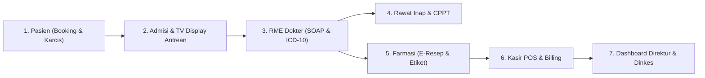

# Panduan Akun Demo & Skenario Pitching Komersial SehatKu HMS

Dokumen ini disusun sebagai panduan operasional resmi untuk presentasi penjualan (sales pitching), demonstrasi produk ke calon pembeli/direksi rumah sakit, serta panduan pengujian menyeluruh (end-to-end testing) SehatKu Hospital Management System.

---

## 1. Ringkasan Kredensial Akun Demo

Sistem SehatKu HMS telah dilengkapi dengan data awalan (database seed) komprehensif yang siap digunakan langsung tanpa konfigurasi tambahan.

Semua akun menggunakan kata sandi standar yang sama untuk mempermudah proses demonstrasi:
- **Default Password:** `password123`

### Tabel Akun Pengguna

| Peran (Role) | Nama Pengguna | Email Login | Password | Akses & Wewenang Utama |
| :--- | :--- | :--- | :--- | :--- |
| **Hospital / Super Admin** | Budi Santoso | `admin@sehatku.id` | `password123` | Akses penuh: Master data dokter/poli, manajemen tarif, inventori farmasi, laporan LB1 Dinkes, rekap keuangan, audit trail. |
| **Dokter Spesialis Jantung** | dr. Maya Pratama, Sp.JP | `doctor@sehatku.id` | `password123` | Modul RME Dokter: Antrean poli jantung, input SOAP, diagnosa ICD-10, e-resep, lembar CPPT ranap, cetak SKD digital. |
| **Dokter Gigi & Mulut** | drg. Rafi Akbar, Sp.KG | `rafi@sehatku.id` | `password123` | Modul RME Dokter: Pelayanan poli gigi, odontogram, tindakan pembersihan karang (scaling), penambalan. |
| **Pasien (BPJS Kesehatan)** | Nadia Putri | `patient@sehatku.id` | `password123` | Modul Pasien Mobile: Booking dokter online, unduh karcis antrean barcode, riwayat resep & resume medis digital. |
| **Pasien (Asuransi Swasta)** | Raka Mahendra | `raka.mahendra@gmail.com` | `password123` | Penjamin asuransi Prudential, riwayat rawat jalan neurologi. |
| **Pasien (Umum / Mandiri)** | Siti Rahmawati | `siti.rahmawati@gmail.com` | `password123` | Pasien pembayaran mandiri non-asuransi. |

> [!NOTE]
> Pada aplikasi mobile dan web SehatKu HMS ([`login_screen.dart`](file:///Users/macbookpro/development/sehatku_hms/sehatku_hms_mobile/lib/features/authentication/presentation/login_screen.dart)), tersedia fitur **Quick Role Switcher**. Presenter cukup menekan tombol tab peran (Pasien, Dokter, atau Admin) pada kartu login; form email dan password akan terisi secara otomatis tanpa perlu mengetik manual di hadapan audiens.

---

## 2. Alur Demonstrasi Penjualan (7 Skenario Pitching)

Skenario demonstrasi berikut dirancang berurutan selama 10 hingga 15 menit untuk memperlihatkan efisiensi alur kerja tanpa kertas (paperless) dari sisi pasien, klinisi, apotek, hingga manajemen keuangan rumah sakit.



---

### Skenario 1: Portal Pasien Mandiri (Mobile Experience)
*Tujuan: Memperlihatkan kemudahan registrasi mandiri pasien tanpa antre panjang di loket fisik.*

1. Masuk ke aplikasi menggunakan akun Pasien:
   - Pilih tab **Pasien** pada layar login (terisi otomatis `patient@sehatku.id`).
   - Tekan **Masuk**.
2. Sorot fitur utama beranda pasien:
   - Informasi kartu pasien digital lengkap dengan Nomor Rekam Medis (Nomor RM: `MRN-2026-001`).
   - Status kepesertaan penjamin: `BPJS Kesehatan Mandiri`.
3. Demonstrasikan pencarian jadwal dokter:
   - Buka menu **Booking Janji Temu**.
   - Pilih poli **Kardiologi & Vaskular** dan dokter **dr. Maya Pratama, Sp.JP**.
   - Pilih tanggal layanan hari ini dan sesi jam praktek.
4. Tunjukkan tiket antrean digital:
   - Tiket langsung terbit dengan nomor antrean `A-001`.
   - Kode QR karcis siap discan di pintu masuk rumah sakit.

---

### Skenario 2: Admisi & TV Display Panggilan Suara
*Tujuan: Menunjukkan integrasi hardware audio-visual rumah sakit pintar (Smart Hospital).*

1. Buka layar antrean pada peramban terpisah atau monitor kedua:
   - Buka rute `/queue` atau modul TV antrean poli.
2. Tunjukkan tampilan TV Display:
   - Kolom antrean aktif per poliklinik (Kardiologi, Gigi, Penyakit Dalam).
   - Indikator status: Menunggu, Dipanggil, dan Sedang Diperiksa.
3. Simulasi Check-in Pasien:
   - Nomor tiket `A-001` terdeteksi telah check-in di admisi.
   - Status antrean pada dashboard otomatis diperbarui secara real-time.

---

### Skenario 3: Rekam Medis Elektronik (RME) Dokter & E-Resep
*Tujuan: Menonjolkan kepatuhan regulasi Permenkes RME, antarmuka efisien dokter, dan akurasi peresepan.*

1. Masuk menggunakan akun Dokter:
   - Pilih tab **Dokter** pada layar login (`doctor@sehatku.id`).
   - Tekan **Masuk**.
2. Panggil Pasien:
   - Di dashboard poliklinik kardiologi, tekan tombol **Panggil Pasien (A-001)**.
   - Sistem membunyikan nada ding-dong lonceng dan memutar suara Text-to-Speech otomatis bahasa Indonesia: *"Nomor antrean A-001, silakan menuju Ruang Poli Kardiologi"*.
3. Entri Rekam Medis SOAP:
   - Buka form pemeriksaan rekam medis pasien Nadia Putri.
   - Periksa riwayat vital sign (Tekanan Darah: `135/85 mmHg`, HR: `78x/menit`).
   - Cari diagnosa ICD-10 dengan autocomplete: ketik `I10` -> Pilih `Essential (primary) hypertension`.
4. Resep Elektronik (E-Prescription):
   - Tambahkan item obat: `Amlodipine 5mg` (1x1 tablet, diminum pagi hari sesudah makan).
   - Tambahkan item kedua: `Bisoprolol 2.5mg` (1x1 tablet).
5. Terbitkan Surat Keterangan Sakit (SKD):
   - Tekan tombol **Cetak Surat Istirahat Dokter**.
   - Tunjukkan dokumen PDF yang dihasilkan dengan kop surat resmi rumah sakit dan QR code verifikasi keabsahan dokumen.
6. Tekan **Simpan & Selesaikan Pemeriksaan**.

---

### Skenario 4: Manajemen Rawat Inap (Ranap) & CPPT
*Tujuan: Memperlihatkan alur kolaborasi dokter rawat inap dan pemantauan ketersediaan tempat tidur.*

1. Masuk ke menu **Rawat Inap (Inpatient)** pada dashboard dokter/admin:
   - Tampilkan denah bangsal dan status ketersediaan tempat tidur (Bed Occupancy Rate / BOR).
   - Tunjukkan visualisasi kamar: Kelas VIP, Kelas 1, dan Ruang ICU/ICCU.
2. Catatan Perkembangan Pasien Terintegrasi (CPPT):
   - Buka salah satu pasien aktif yang dirawat di Ruang Mawar Bed 02.
   - Tinjau lembar grafik suhu, tensi berkala harian, dan instruksi terapi DPJP.
   - Tambahkan catatan perkembangan harian dan tandatangani secara digital (e-sign).

---

### Skenario 5: Modul Farmasi & Apotek Terintegrasi
*Tujuan: Membuktikan resep dokter langsung tiba di meja apotek seketika tanpa kertas resep tercecer.*

1. Masuk ke modul **Farmasi & Apotek**:
   - Resep dari dr. Maya Pratama untuk pasien Nadia Putri langsung muncul dengan status *Menunggu Peracikan*.
2. Proses Telaah Obat:
   - Verifikasi telaah resep (dosis, rute, frekuensi, potensi alergi).
   - Tekan tombol **Proses Racik Obat**.
3. Cetak Etiket Obat Otomatis:
   - Tekan tombol **Cetak Etiket**.
   - Sistem mencetak label stiker obat ukuran standar apotek berisi: nama pasien, nama obat, dosis pemakaian, dan aturan makan.
4. Serahkan Obat:
   - Tekan **Selesai & Serahkan ke Pasien**.
   - Stok fisik Amlodipine dan Bisoprolol pada database otomatis berkurang secara real-time.

---

### Skenario 6: Kasir POS, Agregasi Tagihan & Billing
*Tujuan: Menunjukkan penagihan terintegrasi otomatis dan kecepatan proses kasir tanpa salah hitung.*

1. Buka modul **Billing & Kasir**:
   - Cari tagihan atas nama pasien Nadia Putri.
2. Agregasi Otomatis (Auto-Billing):
   - Tunjukkan rincian komponen biaya yang otomatis terkumpul dari poliklinik dan farmasi:
     - Biaya Konsultasi Dokter Spesialis Kardiologi: Rp 50.000
     - Biaya Pemeriksaan EKG Jantung: Rp 75.000
     - Biaya Obat Resep Farmasi: Rp 37.000
   - Tunjukkan penyesuaian penjamin: Tercover BPJS Kesehatan Mandiri sesuai plafon.
3. Metode Pembayaran Multi-Channel:
   - Pilih metode pembayaran: QRIS Dinamis, Tunai, atau Kartu Debit.
   - Cetak kwitansi pembayaran resmi format thermal 58mm atau cetak invoice A4 PDF.

---

### Skenario 7: Executive Dashboard Direktur & Ekspor Dinkes
*Tujuan: Menutup presentasi dengan memberikan nilai bisnis strategis bagi jajaran manajemen rumah sakit.*

1. Masuk menggunakan akun Administrator:
   - Akun: `admin@sehatku.id` / `password123`.
2. Dashboard Analitik Real-Time:
   - Grafik kunjungan pasien rawat jalan vs rawat inap per hari/minggu/bulan.
   - Analitik waktu tunggu rata-rata pasien (Key Performance Indicator pelayanan).
   - Ringkasan pendapatan harian kasir per metode pembayaran.
3. Modul Kepatuhan Regulasi Kemenkes (SatuSehat Ready):
   - Buka menu **Laporan Dinas Kesehatan (LB1)**.
   - Tampilkan tabel 10 Besar Penyakit terbanyak bulan berjalan (Hipertensi, ISPA, Diabetes Melitus).
   - Tekan tombol **Ekspor CSV / Excel** untuk memperlihatkan data yang siap dikirim ke dinas kesehatan daerah.

---

## 3. Prosedur Reset Data Demo (Clean Slate)

Sebelum memulai demonstrasi di hadapan calon klien baru, pastikan seluruh transaksi latihan sebelumnya telah direset ke kondisi data awal yang bersih.

### Metode 1: Menggunakan Perintah Docker (Direkomendasikan)
Jalankan perintah berikut di terminal server atau laptop demo:

```bash
# Masuk ke container backend dan jalankan database seeder
docker compose exec backend npm run seed
```

Atau jika ingin mereset total seluruh database dari nol:

```bash
docker compose exec -T postgres psql -U postgres -d sehatku_hms < database/seed.sql
```

### Metode 2: Jalankan Langsung di Lingkungan Pengembangan Lokal
Jika menjalankan backend tanpa Docker:

```bash
cd sehatku_hms_backend
npx prisma db seed
```

Proses reset hanya membutuhkan waktu kurang dari 3 detik dan seluruh riwayat antrean serta transaksi siap digunakan kembali untuk demo baru.

---

## 4. Checklist Persiapan Teknis Presentasi

Gunakan daftar periksa berikut 15 menit sebelum presentasi kepada calon pembeli dimulai:

- [ ] Pastikan container Docker backend dan database PostgreSQL berstatus `running` (`docker compose ps`).
- [ ] Buka peramban utama untuk aplikasi web SehatKu HMS pada resolusi layar 100% atau 125%.
- [ ] Buka tab kedua untuk tampilan TV Display Antrean (`/queue`).
- [ ] Nyalakan audio speaker laptop/ruangan untuk memperdengarkan lonceng ding-dong dan panggilan suara otomatis pasien.
- [ ] Siapkan simulator mobile atau buka browser dengan inspect mobile view untuk mendemonstrasikan pengalaman aplikasi pasien.
- [ ] Uji coba login 1-klik menggunakan Quick Role Switcher untuk memastikan koneksi backend lancar.
